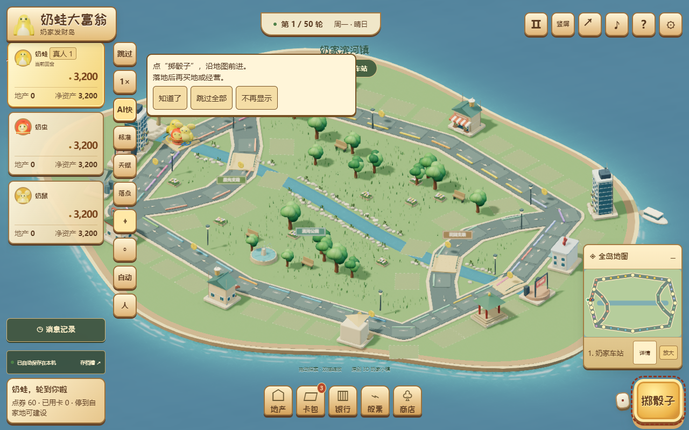

# 桌面卡顿与遮挡修复（2026-10-30）

用户截图中的资产、竖排按钮和“自适应”文字发生遮挡。根因是184px侧栏中头像、姓名、真人标识和现金强行同排，卡片的最小内容宽度超过侧栏；44px工具按钮也放不下三字文案。卡顿则来自持续绘制、桌面较高屏幕空间预算和大量装饰球面三角形。

## 修复

- 资产卡使用两列网格，现金单独分行，长姓名和资产标签可换行；保留可读字号和44px触控目标，不通过裁掉金额解决遮挡。工具栏按钮改用“自动”两字。
- 桌面自动画质上限DPR1.25、阴影1024，关闭额外GTAO，保留物理材质、反射、辉光和抗锯齿。若连续慢提交超过40ms、累计8帧，会自动回退至省电；零星慢帧不会来回切换。手动切换画质可重试。
- 装饰球面从48×36降为32×24分段，角色主造型曲面不变。仅减少画面网格，不改变规则精度、AI、种子、命令或存档。
- 普通对局等待操作时也按需渲染，不再要求用户开启减少动态效果。棋子移动、资金/建设演出、镜头和角色室仍可动画。背景烟雾只在移动时补充，避免静止场景自己维持无限动画循环。隐藏页面暂停，恢复或点击可重绘。

## 测量

同一台Intel UHD/ANGLE桌面Chromium，1280×720、DPR1、种子1701、六人及发展后地产；基线为已发布main提交dffb42e。各三轮，每轮24帧，取分位数的三轮中位数。基准强制连续绘制，仅用于比较每帧成本；实际游戏静止时另用真实WebGL计数器验证停止绘制。

| 指标                         |     修复前 |    修复后 |
| ---------------------------- | ---------: | --------: |
| 帧间隔P50                    |    130.1ms |    51.3ms |
| 帧间隔P95                    |    141.6ms |   102.2ms |
| 每帧绘制提交                 |       6705 |      1708 |
| 每帧提交三角形（含额外pass） | 26,039,137 | 4,196,184 |
| 几何体 / 纹理                |  452 / 138 | 452 / 118 |

本机重场景触发了自动省电回退。P50降低约61%，P95降低约28%；仍有长帧，不能宣称重场景稳定60FPS，也不能把本机数据当作用户设备实测。三轮AI结果完全一致。所有分位数为主线程实际drawFrame间隔，不是独立GPU显示时间。原始记录见 [desktop-playability.json](data/desktop-playability.json)。

复现：设置PERF_ONLY=desktop、PERF_FRAMES=24，运行 `node tools/benchmark.mjs artifacts/desktop-after-1.json`；设置PERF_BASELINE=dffb42e2f8fbc0f8c61fb5745114976001fa65e3可读取旧dist。三轮数据用 `node tools/desktop-report.mjs` 汇总。

## 回归

新增浏览器检查853/1280/1920px宽、DPR1.5、六人及八位金额，检查卡片和文字均在侧栏内，画质按钮不溢出。旧版按钮溢出断言先失败，修复后通过。

实际页面在未开启减少动态效果时统计WebGL draw调用，等待真人操作后停止，点击回到全岛可再次绘制。另检查普通/减少运动、暂停/隐藏、移动/缩放、画质循环、真实WebGL丢失恢复和重复销毁。未伪造真机测试。

本地最终：516项单元测试、4项桌面页面交互（含真实WebGL）、8项渲染生命周期检查通过，类型与增量规范通过。同一普通待机测试指向旧版dffb42e时明确失败，指向修复版时通过；未以强制点击或静态HTML断言替代交互。

