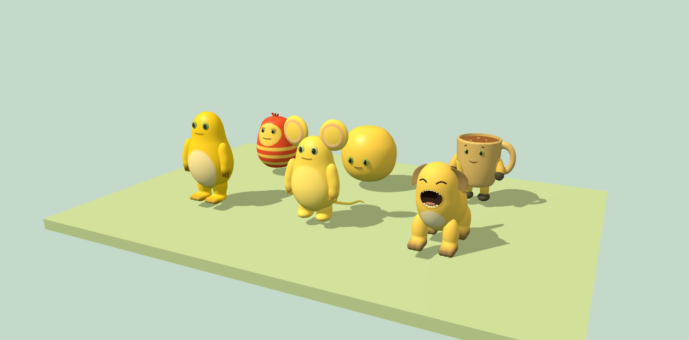
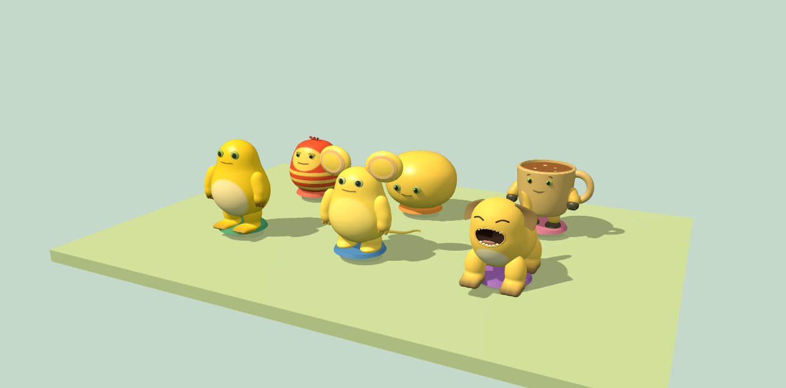
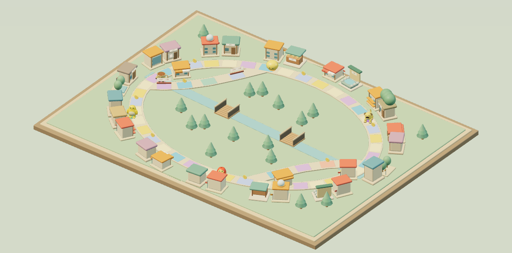
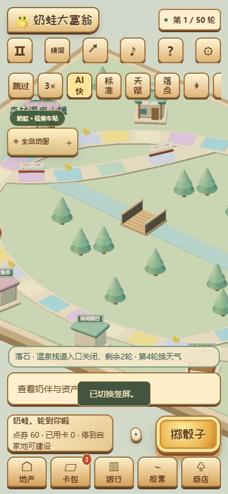
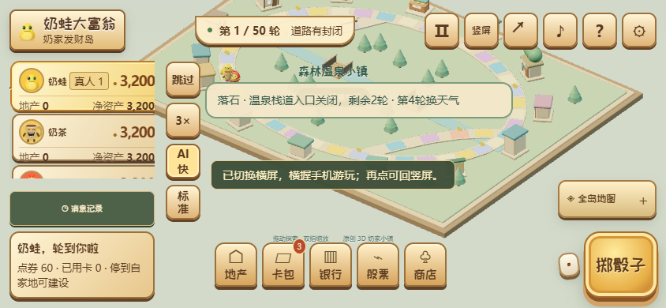

# 森林温泉小镇与玩具立体风

本轮围绕本机玩法：支持单人＋AI、2—6席热座、纯AI旁观。首页隐藏联机入口，保留现有联机代码及自托管回归；撤回上轮未提交的公网部署修改，没有采购服务器、域名或建设邀请链接。

## 画面与交互

六角色共享圆润比例、低粗糙度涂层、眼睛高光、角色色收藏底座与接触阴影；保留奶蛙轮廓、奶虫条纹、奶鼠大耳、奶狗四足、奶蛋蛋形与奶茶杯把。统一待机、行走、开心与受挫动作，减少动态效果保留静态情绪表达。先以奶蛙和温泉建筑检查样板，再扩展至全部角色。

前后采用相同相机、灯光、固定动画时间与六角色布局，程序直接渲染，没有修图。木色地台、奶油墙体、鼠尾草绿松林、青色温泉与角色色屋顶形成沙盘主题。森林建筑根据住宅/连锁/旅馆/商场/加油站/研究所/公园类型与等级生成；公共建筑保留名称标牌。天气使用文字、入口横杆和2D红色虚线，避免粒子遮挡。

| 改造前                                      | 改造后                                                         |
| ------------------------------------------- | -------------------------------------------------------------- |
|  |  |

样板可通过仓库静态服务打开 `tools/forest-preview.html?cast` 或 `?built` 复现。正式游戏仍保留自适应/省电画质、减少动态效果、触控拖动缩放和手动旋转，不调用系统方向锁。

## 规则与兼容

- 内置地图编号4；自定义地图仍为3。48格：主环0—39、松林支路8→40—43→16、温泉支路28→44—47→36，各省3步。
- 第1、4、7……轮，在首位玩家行动（热座交接）前抽取天气，四种等概率，仅新地图额外消耗一次确定性随机数。晴朗开放；暴雨关闭第一支路2轮；落石关闭第二支路2轮；山雾关闭两条支路1轮。期限含出现当轮。
- 主环永不封死；关闭的是从外部进入支路的入口。内部玩家正常离开；倒退不能从汇合点重新进入关闭支路，历史无效时按相邻主环继续，避免跳格。实际移动、预览、卡牌范围、分岔命令与AI复用 `Game.routes`。
- 天气为独立公共覆盖层，不改原始连接、不消费玩家路障或护盾。路障仍在实际踏入时停止移动，事件护盾仍只拦截负面事件。
- 旧图13事件池不变；森林追加温泉补给15点券（150上限，显示实际到账）、山货交易120现金（复用收入加成）、维护费100（复用防护与债务流程）。数据与文案集中在 `forest-rules.js`。
- 存档记录天气类别、起始轮、截止轮、下次变化轮和随机状态，恢复校验期限。旧图不添加天气字段，保留固定种子哈希。旧图规则11回放仍可播放；森林规则12，版本与地图不匹配拒绝，避免用新路线误播旧记录。

## 模拟与数值选择

使用 `node tools/forest-balance.mjs 100 artifacts/forest-balance-100.json`，种子2001—2100，2—6席轮换、三种难度轮换、50轮上限、全部AI，每97条命令重新恢复存档并核对哈希。100局覆盖全部15种人数/难度组合。

| 维护费      | 平均轮数 | 玩家破产率 | 支路利用率 | 每人每命令现金绝对变化均值 |
| ----------- | -------: | ---------: | ---------: | -------------------------: |
| 100（保留） |     49.9 |       8.0% |     37.83% |                      9.587 |
| 80（比较）  |     49.9 |       8.0% |     37.66% |                      9.604 |

较低维护费没有改善本组破产率或时长，因此不据此修改初始100。支路利用率分母为正向实际经过8/28的次数（包括当时封路），不是开放时的偏好概率；资金波动包含交易和结算，不能理解为每回合净收入。

| 角色 | 胜局 / 出场 | 出场胜率 |
| ---- | ----------: | -------: |
| 奶蛙 |     9 / 100 |    9.00% |
| 奶虫 |     33 / 87 |   37.93% |
| 奶鼠 |      4 / 74 |    5.41% |
| 奶狗 |     31 / 60 |   51.67% |
| 奶蛋 |     22 / 46 |   47.83% |
| 奶茶 |      1 / 33 |    3.03% |

出场数不等，统计并列冠军；这不是经过席位、角色、人数与种子完全配对的因果比较。差异明显，不能宣称角色已经平衡。后续应扩大配对种子样本，再分别调整角色能力，避免用地图维护费掩盖角色差异。逐局种子、难度、指令数、资产变化和最终哈希见 [100维护费数据](data/forest-balance-100.json) 与 [80对照数据](data/forest-balance-80.json)。

## 性能与验证

固定旧场景种子1701、六人、七类建筑、相同画质，改造前基于本机提交51a089735f24be905a40a1b8ee05a94ef4cc79bb（与GitHub主线69fe9698690fe0e0b457c1aa520e1e9c43c47e05的文件树完全相同，可用后者复现），改造后为本分支。桌面1280×720/DPR1，移动仿真390×844/DPR3/CPU四倍限速。首先前后交替完成三轮；发现旧图路线查询的无效过滤后，移除这部分开销，并单独再测最终版本三轮。所有基准期间不并行运行单元、浏览器或模拟任务。每组请求32帧；汇总三轮分位数的中位数。脚本记录实际WebGL帧间隔、绘制次数、提交三角形、几何体/纹理/程序数量和高手AI耗时；这些资源数量不是精确显存字节。帧时来自真实drawFrame调用的墙钟间隔，提交计时可能包含驱动等待，不是独立GPU计时或显示器呈现时间。

| 固定旧场景 | 帧时P50/P95 ms：前 → 后       | 高手AI P50/P95 ms：前 → 后 | P95回退 |
| ---------- | ----------------------------- | -------------------------- | ------: |
| 桌面       | 128.7 / 138.5 → 129.8 / 134.9 | 0.9 / 1.2 → 1.2 / 1.5      |  −2.60% |
| 移动仿真   | 113.1 / 132.6 → 118.2 / 136.7 | 4.8 / 7.9 → 6.0 / 9.4      |  +3.09% |

旧场景每帧绘制约6685→6705次，三角形约2604万，几何体443→454、纹理138→138、程序46→46。三轮原始数据保留动画相位造成的细微提交差异。旧图不再进行天气过滤；AI仍有约0.3/1.5ms的P95增量，未达到需要迁移Worker的阻塞程度，不改变规则精度或确定性。

新地图六人、分布交通工具和代表建筑的独立基准：桌面P50/P95为16.6/366.7ms，移动仿真46.9/50.4ms；桌面自适应画质存在偶发长帧，不能宣称稳定60FPS。桌面约3758次绘制/838万三角形/235几何体/52纹理/31程序，移动约3738次/830万/237/52/31。该组不是旧地图的性能替代指标。

自适应桌面保持DPR1、2048阴影、16 GTAO样本；移动粗指针保持DPR上限1.25、1024阴影、8样本半分辨率AO；省电关闭阴影和后处理。没有为满足门槛降低旧档画质。菜单和减少动态效果的静止场景按需绘制，隐藏页面暂停。

资源生命周期检查在1280×800和390×844运行三轮“旧图1→旧图2→森林图”及auto/low往返，最后两轮均为247几何体、35纹理、65程序，未逐轮增长；销毁后scene为空、raf为null、canvas移除。共享几何和材质缓存保留以复用，数量不等于显存字节，也不声称驱动显存已清零。原始记录见 [资源检查](data/forest-resource-cycles.json) 和 [新图基准](data/forest-new-map-performance.json)。

完整原始结果、质量设置和AI输出一致性摘要见 [三轮性能数据](data/forest-performance.json)。运行 `node tools/forest-report.mjs` 会检查旧场景P95回退不超过10%，并核对旧AI决策结果一致。新地图另外运行 `npm run benchmark:forest` 基准，不与不存在的旧森林场景作比较。

最终验证结果（2026-10-29，本机Windows/Chromium）：

| 检查                                                 | 结果                                                     |
| ---------------------------------------------------- | -------------------------------------------------------- |
| 全部单元、规则、天赋、AI、存档、回放、守恒与完整对局 | 515通过，0失败                                           |
| 通用浏览器交互                                       | 104通过，6项可选WebGL默认跳过                            |
| 森林完整交互（开启真实WebGL）                        | 14通过；其中4项为真实WebGL专用流程，补跑默认跳过的森林项 |
| 工程浏览器回归                                       | 6通过                                                    |
| 360×800、390×844、844×390、768×1024、1440×900        | 20通过，含真实触控、四安全区、滚动隔离、软键盘尺寸收缩   |
| 保留的双客户端联机                                   | 14通过，2项可选WebGL未运行                               |
| 云存档双设备流程                                     | 16通过                                                   |
| 类型、增量规范、网站与离线构建                       | 通过；离线HTML约1.37MiB                                  |
| 三轮旧场景前后基准、AI输出一致性、资源生命周期       | 通过记录中的门槛；新图桌面仍有偶发长帧                   |

较宽移动套件先发现旧人数文案选择器过时，改为当前席位名称；随后发现360px玩家列表展开时教程浮层挡住收起按钮。修复为展开列表期间暂时隐藏浮层与天气条，最后完整20项重跑通过。森林天气条移到竖屏主要操作上方，并补充工具栏/操作栏交叠断言。没有以强制点击绕过遮挡。

CI加入森林真实WebGL交互和地图/画质资源循环检查，失败截图、追踪和报告继续上传。通用套件另有2项旧演出WebGL专用测试未在本轮单独运行；不把默认跳过项目计为通过。

Chromium 移动仿真中的实际渲染：

| 390×844                                             | 844×390                                         |
| --------------------------------------------------- | ----------------------------------------------- |
|  |  |

桌面Chromium和移动仿真不代表真机；Android、iOS、移动GPU、设备发热和系统软键盘尚未真机验证。
