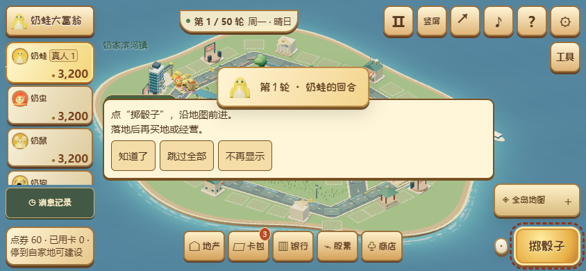
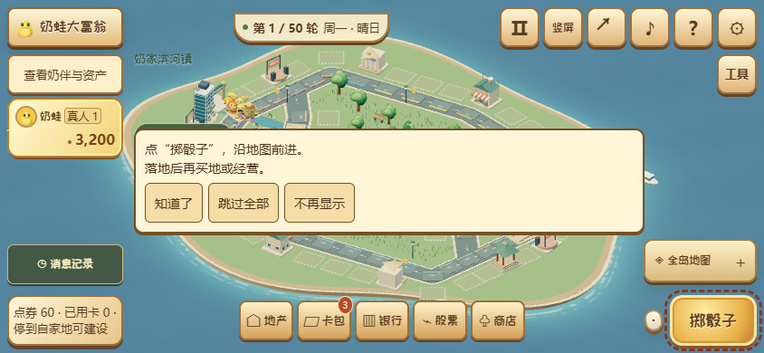

# 第二轮：手机负担与交互基线

紧凑布局优先返回已有 SVG 头像，命中缓存之前也遵守此策略；从桌面切入紧凑布局时释放装饰渲染器。角色近看继续复用主场景的 3D 渲染器。紧凑横屏默认保留当前玩家，其余资产通过可展开抽屉查看；地图工具保持折叠。四向安全区沿用逻辑旋转映射，简洁地图继续独立滚动。

## 三轮同画质比较

基线 4016676；固定六人、种子1701、第12轮、所有地产已建设，地图2。桌面1280×720/DPR1/CPU1，移动390×844/DPR3/CPU4；两者实际低画质、像素比1、阴影和AO均关闭。每次64帧目标，前后交错测三轮；采用三轮P95的中位数。GPU为 Intel UHD / ANGLE D3D11。这是同一台电脑的视口仿真，不是真机帧率。

| 档位           | 前P95三轮 ms       | 后P95三轮 ms       | 中位数变化 |
| -------------- | ------------------ | ------------------ | ---------- |
| 桌面低画质     | 56.4 / 65.0 / 55.3 | 56.6 / 57.0 / 55.5 | +0.35%     |
| 移动仿真低画质 | 46.7 / 44.7 / 45.8 | 47.7 / 46.6 / 44.2 | +1.75%     |

两档均满足回退不超过10%的门槛。主场景没有改模型和规则，单帧均为1708次绘制、4189272个三角形、453个几何体、118张纹理、23个程序；不把该结果宣称为场景帧率提升。真实完整手机界面的装饰WebGL上下文由1降到0，主3D画布保持1个。低画质资源循环三轮稳定；每次销毁均停止RAF、移除画布。

自动画质独立记录：桌面与移动仿真在测量阶段均已自动降至low，P95分别57.5ms、49.5ms；程序与纹理缓存受到先前完整画质初始化影响，不能与固定低档直接混比。原始分轮数据、AI输出哈希、资源循环与释放结果见 [性能记录](data/mobile-iteration-performance.json)。所有固定档AI输出哈希一致，菜单与无动画静止场景测量窗口均无额外绘制。

## 交互验收

360×640、360×800、390×844、844×390、768×1024和1440×900使用真实Chromium：实际开局、卡牌选择、掷骰、买地、结束回合，长面板滚动、44px控件命中、13px关键正文、四向安全区、手动旋转、原生触摸拖动/双指缩放、模态滚动穿透、软键盘尺寸收缩与银行确认。软键盘检查为视口收缩模拟，不能替代系统键盘真机验证。

触摸测试使用四周留24px余量的真实地图空白区域，先开启跟随再拖动，并验证跟随关闭和镜头事件；避免Chromium将贴着按钮边缘的触摸修正到可点击浮层。没有绕过命中测试或强制点击。

完整CI新增独立手机交互作业，与原有单元、WebGL、资源循环、工程、联机和云存档兼容检查共同作为合并门槛。最终测试结果与对应CI链接在本轮PR记录。

| 人工设备       | 状态       |
| -------------- | ---------- |
| Android Chrome | 待真机验证 |
| 微信内置浏览器 | 待真机验证 |
| iOS Safari     | 待真机验证 |

前后画面见本轮图片附件；没有新增规则、存档或回放版本。

本地专项结果：38项单元测试、六视口常规交互18项、修正后原生触摸6项、真实WebGL头像/角色室1项通过；类型检查、改动文件检查和网页/离线包构建通过。完整CI须全绿后合并。

| 调整前                                             | 调整后                                            |
| -------------------------------------------------- | ------------------------------------------------- |
|  |  |
